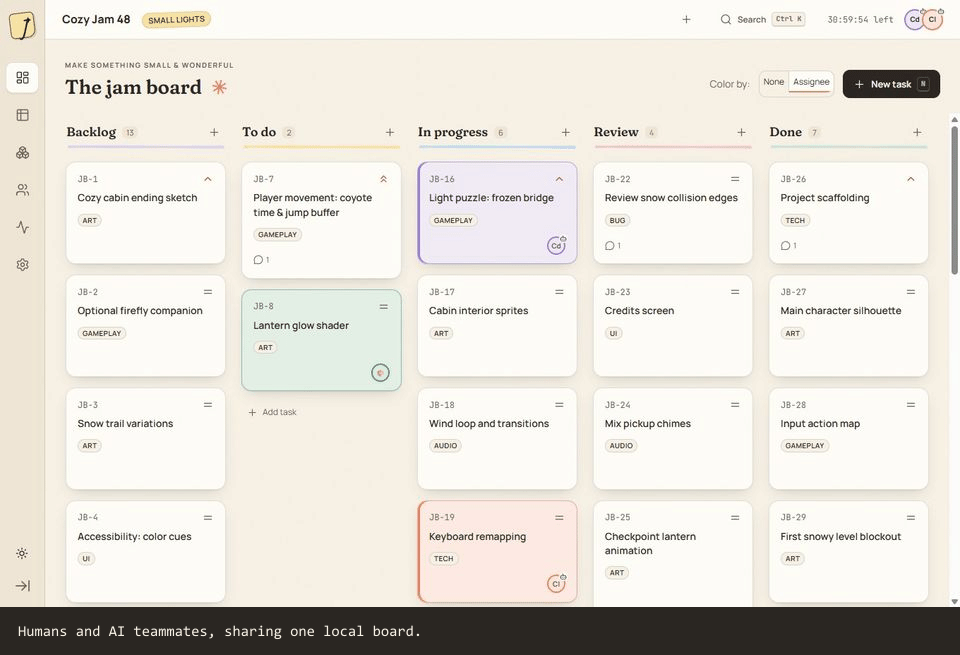
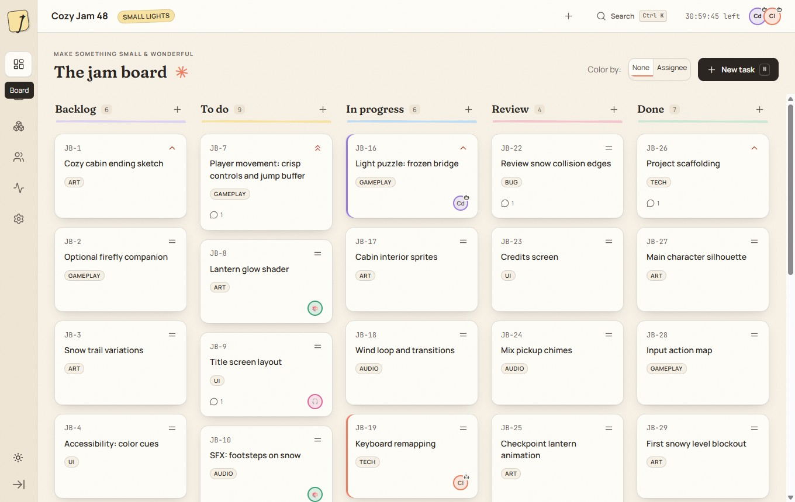
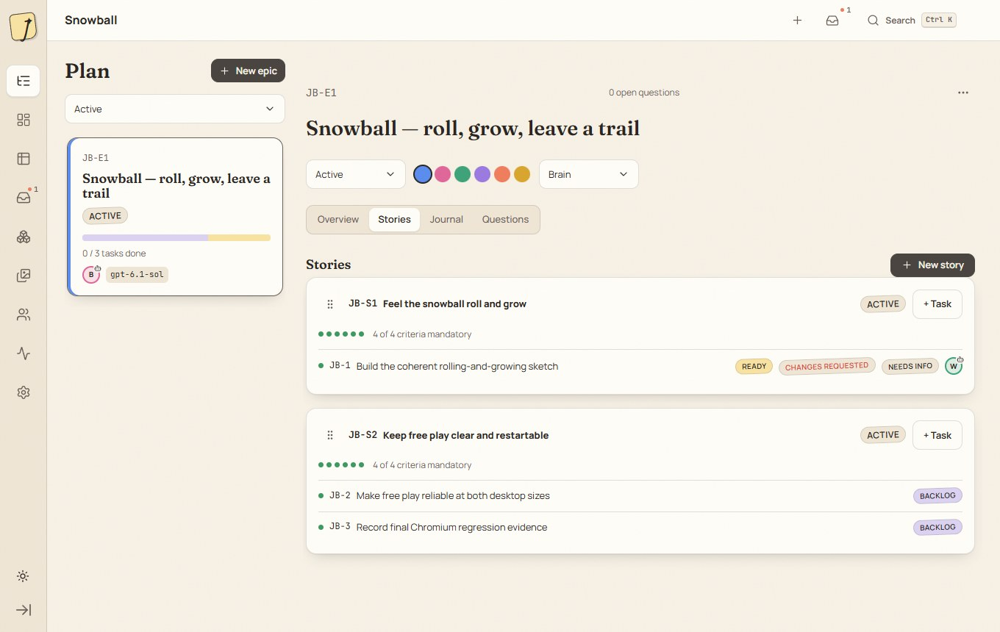
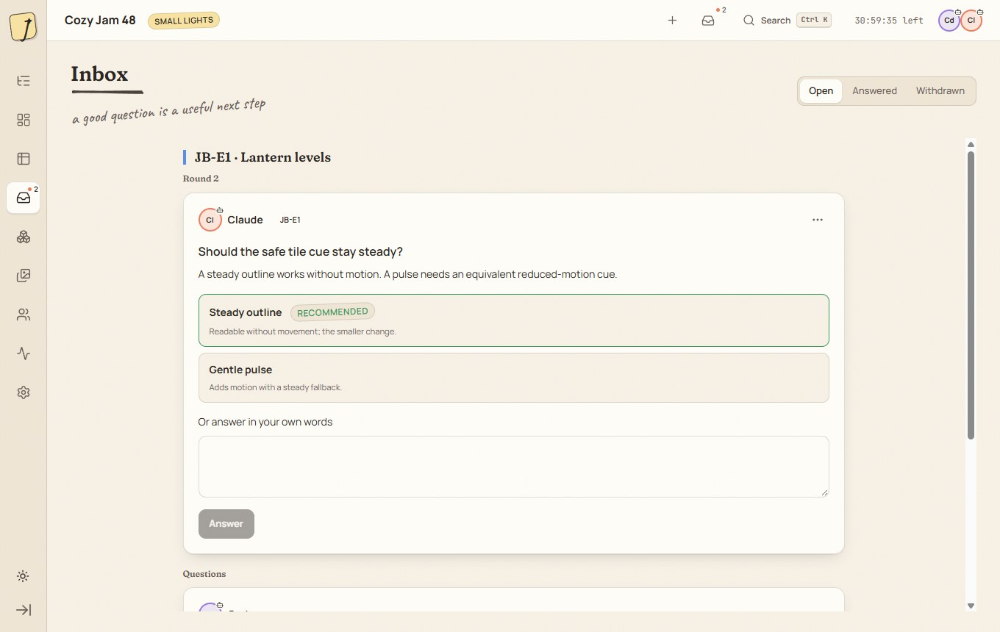
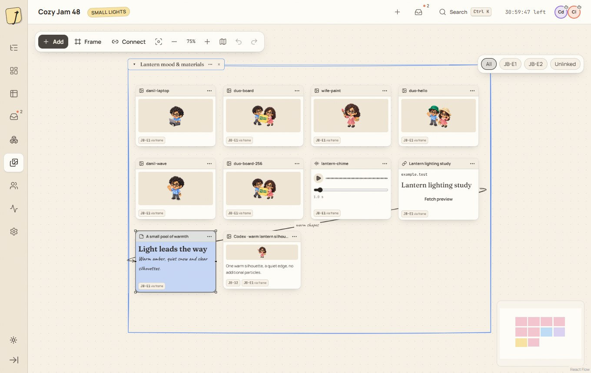
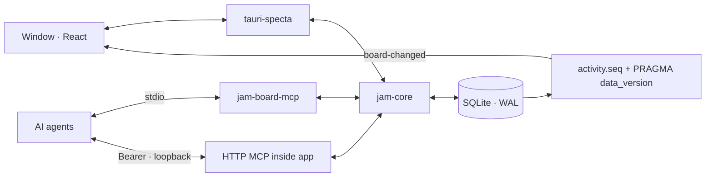

# Jam Board

Local task board where AI agents and humans plan and ship together through MCP

*Plan your project with your AI teammates.*

A cozy local project board for humans and AI teammates. Plan a game jam, a longer game project, a web app or a custom project with a brain agent, give workers clear briefs, and follow questions, reports and reviews in the app.

[](https://github.com/Triton556/jam-board/actions/workflows/ci.yml)
[](LICENSE)




Historical Snowball dogfood recording in the real desktop app (not current-prerelease acceptance): a brain agent asks questions in Inbox, a simulated human operator answers, and the plan and journal update.

> Development prerelease: **0.3.0-alpha.41**. Project-pinned sessions and human-authorized
> story/epic work are implemented. Ready alone never grants execution permission.
> Upgrading an MCP connection: refresh its tool schemas and reread task context;
> alpha5 intentionally requires captured validators on task writes and reviews.
> Alpha15 adds `latestActivityCursor` to session context; strict/cached output
> schemas also need updating. Missing on an older server does not mean zero.
> See the [changelog](CHANGELOG.md) and [verification notes](docs/verification/0.3.0-alpha.29.md).

## Features

- 📝 Epics → stories → tasks, complete briefs and a live five-column board.
- ▶️ Start an agreed story or epic, then let its brain organize workers within that scope. Pause blocks new work without discarding reports.
- 🤖 MCP over stdio and authenticated loopback HTTP: project-pinned sessions, hierarchy resources, planning/work/review prompts and `wait_for_changes`.
- ✨ Live agent changes, with a colored highlight and a toast.
- 🔎 A virtual table tested with 2,000 tasks, with sortable columns and shareable URL filters.
- 🤝 Conflict-safe editing, claim-generation fencing and exact-report review that preserve drafts when the task or its acceptance context changes.
- 🎨 A References canvas, local media, team presence and an epic journal.
- 💾 Local SQLite storage. No cloud, accounts or telemetry. JSON export/import and non-destructive archives.
- 🌙 Light and dark paper themes, self-hosted fonts and optional paper-rustle sounds.
- 🗂️ Separate project boards, a visible project switcher and recoverable project archives.

## Screenshots

| Board | Plan |
|---|---|
|  |  |
| Inbox | References |
|  |  |

These historical screenshots show the earlier Snowball run (Plan) and bundled demo (Board, Inbox and References) in a real desktop window. They are not screenshots of every current control or proof of current-prerelease acceptance. [Dark paper theme](docs/media/readme-board-dark.jpg).

## Plan with a brain agent

New here? Follow [one project from rough idea to reviewed work](docs/first-project.md).

1. Connect the agent in **Settings → Agents**, then appoint it under **Plan → Epic → Brain** (or explicitly ask it in chat to take an unassigned epic’s brain role). Choose the worker model in your agent client.
2. Answer its interview in Inbox. Confirm the goal, done-when and boundaries.
3. Follow the epic, stories and full task briefs in Plan. Only actionable work becomes Ready.
4. Start the agreed story or epic in Plan. Or ask the brain in chat: it creates a typed start request for your exact-scope confirmation in Inbox. This grants work permission; it never launches an agent session.
5. Connected workers claim Ready tasks within that scope and submit reports with real test evidence. A human or the brain accepts them or requests another round.
6. Check the journal and steer the plan with edits, references and answers. The brain asks before closing an epic when your participation calls for it.

**Where are features?** Open **Plan**, select an epic and choose **Stories** (or the story-count button in its overview). A story is the feature-sized outcome with acceptance criteria; its tasks are the implementation briefs. There is no additional Feature level.

**Write naturally first.** Open a Story or Task and use **Description**. Task
**Comments** are the place for wishes and follow-up corrections. **Agent plan**
reveals the structured implementation fields and acceptance checks without
requiring a human to fill them all first. Readiness still uses those fields;
collapsing them does not change permissions or erase content. A Story's description
is its existing outcome field; this increment does not add Story-level comments.

**Rough idea or corrections?** Use **Refine with brain** on an epic, story or task. Review and copy the scoped planning prompt into your connected agent's chat. It asks the brain to read existing notes and references, clarify gaps in Inbox, and reconcile your edits without starting implementation. Copying a prompt does not launch an agent.

## Separate projects

Use **Switch project** in the top bar to open **Your projects**. Create a new project for a separate board, or reopen an existing one. Each project keeps its own plan, tasks, questions, assets and references; immutable key prefixes distinguish their entities.

MCP connections are pinned to one project for their lifetime. Opening another board in the app does not redirect connected agents or pause their work. **Settings → Agents** generates configuration pinned to the selected project's immutable ID (with its name and prefix shown for orientation). Reconnect an agent using that project's configuration when you want it on a different board; `get_session_context` reports its current binding.

For separately tracked brain and worker connections, use distinct stable `JAM_AGENT_NAME` (stdio) or `X-Jam-Agent` (HTTP) values. Another chat or an inherited subagent using the same connection shares its board member identity; it is not automatically an independent worker or reviewer. See **Settings → Agents → Agent identity**.

**Start / Pause:** Ready describes a task brief, while execution permission belongs to its story or epic. Starting an epic includes its inheriting stories; a separately paused story stays paused. Pausing the epic blocks new work in all its stories, including separately started ones. Already-running tasks may still submit evidence. Closing, archiving, restoring or importing work never silently resumes a grant. [Full execution policy](docs/mcp.md#human-authorized-execution).

**Settings → Data → Archive this project** keeps its data for **Your projects → Archived projects → Restore & open**. Finish or release all In progress tasks before archiving, including individually archived cards. Open an In progress card and use **Release claim…** (or **Return to Backlog…** if no assignee is recorded), including archived cards. Confirm the exact holder and task; this returns board tracking to Backlog without stopping a worker process or changing scope permission. Restoring visibility does not authorize new work. Archiving does not silently cancel workers or rewrite individual task archive flags. Data archived by older builds keeps its original per-task flags.

## Inbox

Typed **Start requests** are separate from ordinary planning questions. Only an exact-scope approval grants work; answering a question—even with “start”—does not. Chat-to-approval currently requires that Inbox confirmation; there is no trusted direct chat authorization bridge.

Agents ask through MCP; you answer in the app. Choose a recommended option, write your own answer, or combine both. A task's **Needs info** flag covers its own questions. Story and epic questions stay at their level, while workers still receive ancestor context.

## Review rounds

1. A worker claims a Ready task and calls `submit_report` with its summary, changed files, named test results, deviations and unverified checks.
2. A separate human or the appointed epic brain checks the report against the brief and story acceptance, then accepts it or requests changes. Agents can mark Done only through this independent review—not direct task creation, status changes or release. A human can still mark work Done manually; that is not a recorded review. The assignee and report author cannot review their own work, even if appointed brain.
3. **Changes requested** returns the task to Ready with its assignee retained and a new reporting round. Earlier reports and reviews remain visible.

Returning submitted work to In progress or reopening accepted work also keeps a usable next reporting round. Human edits and review decisions appear in the epic journal.

## References canvas

Drop local images, audio, video or other files onto the canvas, add captions, notes and links, and attach them to epics, stories or tasks. Frames organize an epic's material. Agents can add references live. Files stay where they are; clipboard images alone are saved into the data folder. Links make no network request until you explicitly choose **Fetch preview**.

## Project templates

Choose **Game jam** for a 48-hour countdown, **Gamedev** for a longer game project, **Web app** for product work, or **Custom** to start blank. Gamedev and Web app offer an optional milestone. Switching templates keeps existing tags and work.

## Connect an agent and install optional guidance

In **Settings → Agents**, use **Connect agent to board** to copy one project-bound
setup prompt. It checks existing MCP first, verifies the exact project ID and
reads this version's `jam://guide`. If configuration is missing, the agent must
inspect existing settings, obtain required permission and explain any restart;
the prompt contains no authentication token. It does not appoint a brain, start
work or launch a model. A task or role you separately request determines what
happens next. The optional project folder is a filesystem hint, not board identity.

MCP works without installing files. For local skill discovery, **Install Jam Board
skill** copies the bundled board-owned instructions into the chosen project's
Codex or Claude skill folder. There is no agent-playbook clone, Python dependency
or full-playbook option. Review the destination, then confirm install and verify.

Upgrade preserves a backup outside the skill catalog and checks a matching private
app ownership receipt. Modified files, an existing foreign skill or missing
ownership proof stop before overwrite. For a skill installed by an older playbook,
use that original installer's migration/removal procedure first; this application
never adopts or removes another installer's files silently. Global client settings
and other skills remain unchanged. File verification is not a live-model or MCP
compatibility test. See [standalone skill and migration](docs/agent-playbook-compatibility.md).

## Install

Download the Windows x64 `-setup.exe` from [Releases](https://github.com/Triton556/jam-board/releases). Check the version shown there: a published download may be older than this unreleased development candidate. The local prerelease commits and checks do not imply a public installer/tag/release. Installation is per-user and does not require administrator rights. Windows 11 with WebView2 is the tested platform.

Jam Board is **Windows-first**. This development branch has controlled Linux native
acceptance with explicitly provided runtime dependencies; see the versioned
[verification notes](docs/verification/). That is not a clean-distribution/FUSE
installation guarantee. macOS runtime and the current prerelease's Windows
installation lifecycle remain unverified; Windows CI compilation is separate.
The Windows package includes the MCP sidecar. Use the installer and `SHA256SUMS.txt`
from the same release; the downloaded asset's exact filename identifies its checksum entry.

The installer is **unsigned**. Windows SmartScreen may warn that the publisher is unknown. Only run an installer you trust; compare its SHA-256 with the release's `SHA256SUMS.txt`.

Your database, MCP token and logs live in `%APPDATA%\dev.triton556.jamboard\`. Settings → Data opens the folder. Asset files remain at their original locations. The uninstaller is configured to preserve this data folder. **Installed upgrades and their data-retention behavior have not been verified for this prerelease.** Back up your project with Export JSON before upgrading. To remove data permanently, close the application and stdio agents, back up anything you need, then remove that folder yourself.

## Connect your agent

Open Settings → Agents for snippets containing your actual executable path and port. Keep tokens out of source control. These examples do not modify real agent configurations.

**Codex · stdio** — add to `~/.codex/config.toml`:

```toml
[mcp_servers.jam-board]
command = 'C:\Path\To\jam-board-mcp.exe'
env = { JAM_AGENT_NAME = "Codex", JAM_BOARD_PROJECT = "JB" }
```

**Codex · HTTP** — keep Jam Board open and set `JAM_BOARD_TOKEN` in the environment inherited by Codex, using Copy in Settings:

```toml
[mcp_servers.jam-board-http]
url = "http://127.0.0.1:47321/mcp"
bearer_token_env_var = "JAM_BOARD_TOKEN"
http_headers = { "X-Jam-Agent" = "Codex", "X-Jam-Project" = "JB" }
```

**Claude Code · stdio** — run in PowerShell:

```powershell
claude mcp add jam-board --env JAM_AGENT_NAME=Claude --env JAM_BOARD_PROJECT=JB -- 'C:\Path\To\jam-board-mcp.exe'
```

**Claude Code · HTTP**:

```powershell
claude mcp add --transport http jam-board http://127.0.0.1:47321/mcp --header 'Authorization: Bearer <token>' --header 'X-Jam-Agent: Claude' --header 'X-Jam-Project: JB'
```

Replace `JB` with your project's key prefix from Settings. Without an explicit prefix, a new session captures the currently selected project once; it never follows later UI switches.

Try a read-only check first: *“Use the jam-board MCP server: call get_session_context, get_project and get_board. Tell me which project this connection belongs to and summarize its plan. Do not change the board, claim tasks or start workers.”*

The installed sidecar finds the same default database automatically. For development, also set `JAM_BOARD_DATA_DIR` to `<checkout>/.dev-data`. Agents recover from their saved project/scope/filter checkpoint using bounded `wait_for_changes` with `excludeSelf=false` and `timeoutSeconds=1`; handle each page before saving `nextCursor`, including on timeout, then use `timeoutSeconds=60` only when continued observation is assigned. Finish/report at the assigned stopping condition. Never replace an unprocessed checkpoint with a fresh cursor. For fresh bootstrap only, verify the exact project and capture `get_session_context.latestActivityCursor` before reading current state; follow the [bootstrap and recovery policy](docs/mcp.md#waiting-as-a-brain). `list_changes_since` remains available for deliberate historical audit. See the [full MCP contract](docs/mcp.md) and [v0.2 integration changes](docs/mcp.md#breaking-changes-in-v02).

## How it works



All business rules live in `jam-core`. Tauri commands and MCP tools call the same services, so numbering, claims, ordering and archives behave consistently for people and agents.

SQLite WAL coordinates the separate processes. Each mutation writes one activity event in the same short transaction. The desktop polls `PRAGMA data_version` every 250 ms and forwards new `activity.seq` entries as `board-changed` events.

The frontend refreshes affected query caches, animates agent changes and preserves unsaved human input during conflicts. HTTP stays on loopback with Bearer and Origin checks. See [architecture](docs/architecture.md).

## Development

For larger boards, see [the disposable data-volume and performance checks](docs/performance.md).

Requirements: Rust stable (edition 2024), Node.js 22 or newer, and on Windows MSVC
Build Tools 2022 plus WebView2. Linux build dependencies are in the CI workflow;
the controlled Linux runtime checks and remaining platform limits are recorded in
the [verification notes](docs/verification/). Use the committed lockfiles.

```powershell
cd apps/desktop
npm ci
$env:JAM_BOARD_DATA_DIR = (Resolve-Path ../..).Path + '/.dev-data'
npm run tauri dev
```

From the repository root:

```powershell
node scripts/check-versions.mjs
node --test scripts/check-versions.test.mjs
cargo fmt --all --check
cargo clippy --workspace --all-targets -- -D warnings
cargo test --workspace
```

From `apps/desktop`:

```powershell
npm run check
npm run typecheck
npm test
npx playwright test --project=functional
npx playwright test --project=perf
npx playwright test --project=perf-canvas
npm run tauri build
```

Playwright starts mock-backed Vite servers. Local tests use installed Chrome; CI uses Playwright Chromium. The `perf` project measures production wheel/flick/PageDown scenarios and is manual-only in CI. Set `VITE_MOCK_BRIDGE=1` before `npm run dev` to develop the UI without Tauri. The mock shares generated types and a fixture exported by `cargo run -p jam-core --example export-demo-fixture`.

Set `JAM_BROWSER_PATH` to an already installed Chromium executable when it is not in Playwright's default Chrome location. This selects an executable only; it does not change browser or operating-system permissions. UI design decisions and their source rationale are recorded in [Workflow and usability](docs/workflow-ux.md).

Release builds prepare the sidecar automatically. After `cargo build -p jam-mcp-cli`,
`node scripts/stdio-smoke.mjs` runs the current real-MCP smoke in its own fresh
`.dev-data/stdio-smoke-*` directory. It checks exact binary/schema versions,
complete planning, paused-scope rejection and stale writes without retrying old
payloads. It does not grant execution or launch an agent. Helper tests run with
`node --test scripts/smoke-contracts.test.mjs scripts/smoke-stdio.test.mjs`.

The NSIS installer is written beneath `target/release/bundle/nsis/`. On a **disposable
Windows QA account**, `node scripts/m6-install-check.mjs --fresh-disposable-install`
explicitly installs/uninstalls a per-user fixture. It refuses existing default data,
installation paths and shortcuts, verifies the exact parent-owned native target,
and simulates human Start/review only inside that fresh test project. It removes
only its fresh data after checking uninstall retention; artifacts stay in a unique
`.dev-data/install-check-*` directory. This is not permission to run against an
existing user's installation. The Windows lifecycle requires separate verification;
it is not covered by the local Linux checks.

Historical capture scripts preserve old evidence; their milestone names are not
current executable examples or package-version guarantees. They fail before side
effects on current contracts. Reproduction requires reviewing their original
source/binary/payloads and disposable data, not bypassing the guard. Development
data and raw traces belong in `.dev-data`.

## Tech stack

Tauri 2 · Rust · SQLite · rmcp · React 19 · TypeScript 7 · Vite 8 · TanStack Query/Router/Virtual · Zustand · dnd-kit · React Flow · Motion · Tailwind CSS 4.

## Credits & license

MIT © 2026 Danil Volodin. Built by Danil Volodin with AI coding agents (Codex, Claude Code).

See [CREDITS.md](CREDITS.md) and [third-party licenses](docs/third-party-licenses.md).

## Working on Jam Board

Start with the [agent-facing interaction and acceptance map](docs/agents/README.md).
Keep it current when adding or changing a user or agent action; build and content
integrity checks are not substitutes for functional and visual acceptance.
