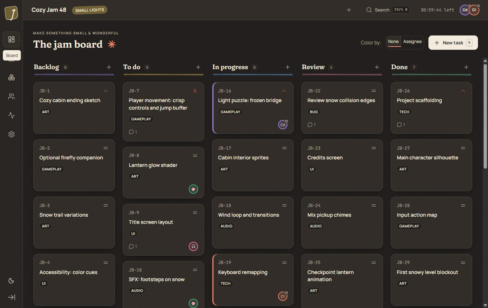
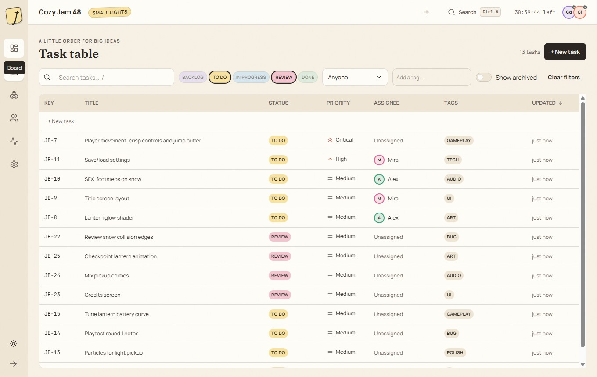
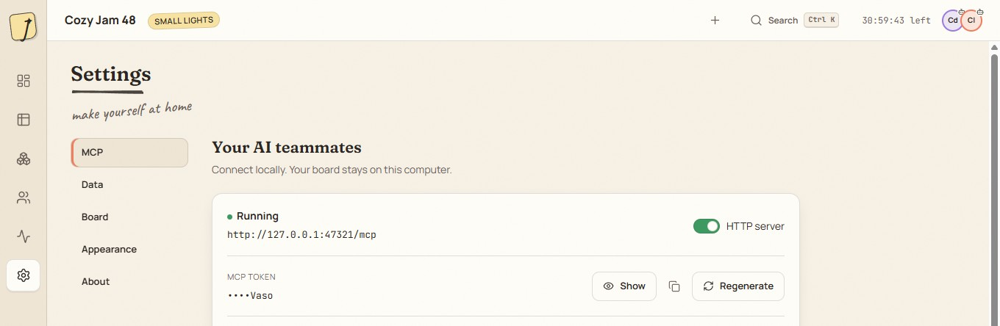
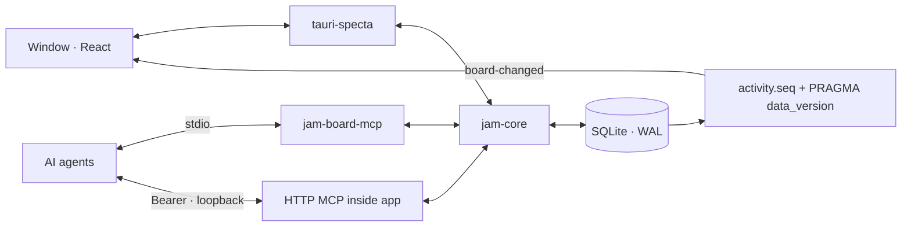

# Jam Board

*Plan your game jam with your AI teammates.*

A cozy local task board for game jams. AI agents like Codex and Claude Code connect through MCP, see the board, claim tasks and add new ones — and you watch it happen live.

[](https://github.com/Triton556/jam-board/actions/workflows/ci.yml)
[](LICENSE)


## Features

- 📝 A live five-column board shared by humans and agents, with keyboard and pointer drag-and-drop.
- 🤖 MCP over stdio and authenticated loopback HTTP: twelve tools, resources and a work prompt.
- ✨ Agent changes arrive in under a second, with a colored highlight and a toast.
- 🔎 A virtual table for 2,000+ tasks, with sortable columns and shareable URL filters.
- 🤝 Conflict-safe editing that preserves your draft when an agent changes the same task.
- 🎨 Asset references, image previews, team presence and a live activity feed.
- 💾 Local SQLite storage. No cloud, accounts or telemetry. JSON export/import and non-destructive archives.
- 🌙 Light and dark paper themes, self-hosted fonts and optional paper-rustle sounds.

## Screenshots

| Board · light | Board · dark |
|---|---|
|  |  |
| Table | MCP settings |
|  |  |

## Install

Download the Windows x64 `-setup.exe` from [Releases](https://github.com/Triton556/jam-board/releases). Installation is per-user and does not require administrator rights. Windows 11 with WebView2 is the tested platform.

The v0.1.0 x64 installer is **7.22 MB** (7,215,091 bytes / 6.88 MiB), including the MCP sidecar.

The installer is **unsigned**. Windows SmartScreen may warn that the publisher is unknown. Only run an installer you trust; compare its SHA-256 with the release's `SHA256SUMS.txt`.

Your database, MCP token and logs live in `%APPDATA%\dev.triton556.jamboard\`. Settings → Data opens the folder. Asset files remain at their original locations. The uninstaller is configured to preserve this data folder; the complete installed round-trip still needs verification on Windows. To remove data permanently, close the application and stdio agents, back up anything you need, then remove that folder yourself.

## Connect your agent

Open Settings → MCP for snippets containing your actual executable path and port. Keep tokens out of source control. These examples do not modify real agent configurations.

**Codex · stdio** — add to `~/.codex/config.toml`:

```toml
[mcp_servers.jam-board]
command = 'C:\Path\To\jam-board-mcp.exe'
env = { JAM_AGENT_NAME = "Codex" }
```

**Codex · HTTP** — keep Jam Board open and set `JAM_BOARD_TOKEN` in the environment inherited by Codex, using Copy in Settings:

```toml
[mcp_servers.jam-board-http]
url = "http://127.0.0.1:47321/mcp"
bearer_token_env_var = "JAM_BOARD_TOKEN"
http_headers = { "X-Jam-Agent" = "Codex" }
```

**Claude Code · stdio** — run in PowerShell:

```powershell
claude mcp add jam-board --env JAM_AGENT_NAME=Claude -- 'C:\Path\To\jam-board-mcp.exe'
```

**Claude Code · HTTP**:

```powershell
claude mcp add --transport http jam-board http://127.0.0.1:47321/mcp --header 'Authorization: Bearer <token>' --header 'X-Jam-Agent: Claude'
```

Try: *“Use the jam-board MCP server: call get_board, then take the highest-priority unassigned To do task, claim it, and add a comment with your plan.”*

The installed sidecar finds the same default database automatically. For development, also set `JAM_BOARD_DATA_DIR` to `<checkout>/.dev-data`. See the [full MCP contract](docs/mcp.md).

## How it works



All business rules live in `jam-core`. Tauri commands and MCP tools call the same services, so numbering, claims, ordering and archives behave consistently for people and agents.

SQLite WAL coordinates the separate processes. Each mutation writes one activity event in the same short transaction. The desktop polls `PRAGMA data_version` every 250 ms and forwards new `activity.seq` entries as `board-changed` events.

The frontend refreshes affected query caches, animates agent changes and preserves unsaved human input during conflicts. HTTP stays on loopback with Bearer and Origin checks. See [architecture](docs/architecture.md).

## Development

Requirements: Rust stable (edition 2024), Node.js 22, and on Windows MSVC Build Tools 2022 plus WebView2. Linux build dependencies are in the CI workflow; Linux runtime and macOS have not been validated for this MVP. Use the committed lockfiles.

```powershell
cd apps/desktop
npm ci
$env:JAM_BOARD_DATA_DIR = (Resolve-Path ../..).Path + '/.dev-data'
npm run tauri dev
```

From the repository root:

```powershell
cargo fmt --all --check
cargo clippy --workspace --all-targets -- -D warnings
cargo test --workspace
```

From `apps/desktop`:

```powershell
npm run check
npm run typecheck
npm test
npx playwright test --project=functional
npx playwright test --project=perf
npm run tauri build
```

Playwright starts mock-backed Vite servers. Local tests use installed Chrome; CI uses Playwright Chromium. The `perf` project measures production wheel/flick/PageDown scenarios and is manual-only in CI. Set `VITE_MOCK_BRIDGE=1` before `npm run dev` to develop the UI without Tauri. The mock shares generated types and a fixture exported by `cargo run -p jam-core --example export-demo-fixture`.

Release builds prepare the sidecar automatically. The NSIS installer is written beneath `target/release/bundle/nsis/`. `node scripts/m6-install-check.mjs` runs the explicit per-user installation check, refuses pre-existing default data, and removes only the fresh data it created after verifying uninstall retention. Development data and raw traces belong in `.dev-data`.

## Tech stack

Tauri 2 · Rust · SQLite · rmcp · React 19 · TypeScript 7 · Vite 8 · TanStack Query/Router/Virtual · Zustand · dnd-kit · Motion · Tailwind CSS 4.

## Credits & license

MIT © 2026 Danil Volodin. Built by Danil Volodin with AI coding agents (Codex, Claude Code).

See [CREDITS.md](CREDITS.md) and [third-party licenses](docs/third-party-licenses.md).
