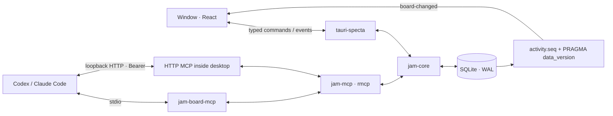

# Architecture

Jam Board runs entirely on the user's computer. There are no accounts, hosted services, analytics, or remote database. Asset files stay in place; SQLite stores references to them.

## Processes and crates

`jam-core` owns migrations, validation, task numbering/ordering, claims, archives, import/export, settings and change feed. It depends on neither Tauri nor rmcp. `jam-mcp` adapts those services to 44 MCP tools, resources, three prompts and authenticated HTTP. `jam-mcp-cli` is the thin stdio binary. `apps/desktop/src-tauri` owns the window, commands, HTTP lifecycle and native integrations; its React frontend lives in `apps/desktop/src`.

The installer places `jam-board.exe` and `jam-board-mcp.exe` together. Installed processes use `%APPDATA%\dev.triton556.jamboard\jam.db`. Development sets `JAM_BOARD_DATA_DIR` to a directory inside `.dev-data`. The CLI resolves `--db`, then `JAM_BOARD_DB`, then `JAM_BOARD_DATA_DIR/jam.db`, then the platform default. The HTTP server exists only while the desktop is open; stdio can work independently.

## One command, one domain implementation

A UI mutation crosses the generated `bindings.ts` through `lib/api.ts`. The Rust command resolves the human from `settings.current_member_id`, runs a core service on `spawn_blocking`, polls the feed, and emits typed events. The frontend never chooses its actor. MCP initialize classifies `clientInfo.name`; `JAM_AGENT_NAME` or `X-Jam-Agent` selects its display identity. Core creates an unknown agent and tracks its heartbeat. Handles/client kinds remain stable when a member is renamed.

Every business mutation records its activity in the same transaction; a typed execution approval records both the human decision and resulting scope start. A task form sends only changed fields and its `expectedUpdatedAt`; a stale version returns `conflict` rather than overwriting another actor. Dirty inputs remain local until the user chooses Keep mine or Take theirs. MCP tools use the same core services; their smaller update contract does not expose the desktop version field.

## Concurrency and live delivery

Each Store owns a mutex-protected writer and two read connections. Connections use WAL, foreign keys, NORMAL synchronous mode and a 5000 ms busy timeout. Short writes begin with `BEGIN IMMEDIATE`. Number allocation, fractional positions, renumbering, idempotency, claim checks and their activity row are atomic. Different desktop/stdio processes coordinate through SQLite rather than a second in-memory source of truth.

`ChangeFeed` reads all rows after its monotonic `activity.seq` cursor. UI commands poll immediately. A dedicated connection checks `PRAGMA data_version` every 250 ms to detect commits made by another process. `board-changed` invalidates Query caches; the UI store adds four-second agent highlights, two-second avatar pulses and up to three five-second toasts. No polling of individual cards is needed. Reduced motion preserves color and text feedback.

The table filters/sorts in SQL and renders a bounded virtual window. Its memoized rows have stable callbacks, cached relative times and lightweight CSS avatars/stamps. Production performance scenarios are intentionally manual and hardware-dependent; functional browser tests use the same API via an in-memory bridge and Rust-exported demo fixture.

## Local security and retained data

HTTP binds only to `127.0.0.1`, requires a random 32-byte base64url Bearer token on every request, and rejects non-loopback Origins. Port fallback is 47321–47330. Token regeneration cancels existing HTTP sessions. The UI renders masked snippets; full values are fetched only for explicit Show/Copy. Stdio reserves stdout for MCP and logs to stderr/files.

Recent tool calls stay in a twenty-item memory ring. An authenticated, bounded loopback metadata channel lets a separate stdio process notify the open window; it does not store arguments or a call log in SQLite. Preview authorization resolves an asset ID in Rust and allows only the canonical registered image file through the initially empty asset-protocol scope. No general frontend filesystem read permission is granted.

Tasks and entire jams are archived, never physically deleted. Import creates a new jam, validates references and remaps keys/IDs, while matching existing member handles. Export excludes settings and tokens. Uninstall retains user data so reinstalling does not destroy a jam. Back up `jam.db` using Export JSON or copy the database while all Jam Board processes are closed.

## Startup and release

The native window starts hidden. After app state is available, the frontend gives local fonts a bounded 250 ms wait and shows the window before waiting for animation frames. Hidden WebKit windows may suspend animation frames, so neither frames nor a route-specific element can gate visibility. A bounded observation of two visible frames precedes `app_ready`; if no frames are observed, the window remains visible without a fabricated first-frame receipt. Rust emits `app-ready` and writes a local `logs/app-ready.json` receipt containing only PID and timestamp. Release measurements compare that timestamp with process creation; it is not telemetry.

Feature screens, the table, task drawer, command palette and Markdown renderer load in separate chunks. Motion and roughjs have dedicated vendor chunks. CI checks both operating systems but only Windows builds the desktop; Linux runtime and macOS are not release targets of this MVP.

## Board preferences and file attachments

Board color mode, optional story-point visibility and the soft In progress WIP limit are stored under the active jam ID in SQLite settings. New jams default to epic-colored paper cards, hidden estimates and a limit of six; estimates remain part of the domain and MCP contract. Asset Grid/List and collapsed-group preferences are application-wide.

Attaching a local file to a task calls one jam-core transaction: validate the active editable task and file, infer its kind/name, insert the asset reference and task link, touch the task version, and append one asset.linked activity event with created=true. No file is copied. A failed link rolls back the asset insertion. Registered-file preview authorization still happens in Rust.

## Project work model (v0.2)

A project retains the jams table, adding a template, optional milestone and transactional epic/story counters. Exactly three levels are enforced with foreign keys: Epic > Story > Task. Tasks cannot have a null story. Planning entities own interview/intent/acceptance fields; tasks own the playbook brief separately from editable Notes. Epic brains are agent members; every permission check is in jam-core, including activation, Ready overrides, Done and review. Humans retain control; workers cannot review their own submissions.

Reports/reviews are immutable per task and review round. A worker submission moves In progress > Review; changes requested returns to Ready with the assignee and history retained. Questions use a validated polymorphic project/epic/story/task scope. Humans answer; each level shows only its own open questions. Task detail separately carries open story/epic questions as ancestorQuestions, preserving worker context without flooding task flags. Cross-process waits release all SQLite locks, then consume the existing activity/data-version feed at 250ms intervals until an answer, matching activity or a bounded timeout. wait_for_changes applies action/actor/self/epic filters, returns at most 100 ordered events and advances nextCursor through every inspected row, including non-matches. Its dedicated read snapshot ends before sleeping; the writer stays available. Presence refreshes add no activity.

activity.epic_id indexes the epic journal; seq remains the project cursor and English event sentences are generated in core. Project interviews before epic creation keep epic_id null. Plan → Journal also displays those earlier project questions, answers and status lines as **Project prelude**, bounded by the preceding epic creation. This is labeled presentation context from the project feed: stored scope, scoped MCP journal reads and event sequence remain unchanged. Scoped agent status updates last_seen_at, records one event and becomes stale after 30 minutes. The separate online threshold stays 120 seconds.

References are a React Flow canvas backed by frames, items, edges and target links. File items create role=reference assets in the same transaction and reference local paths. Adding/rendering a link only stores or reads its URL and never fetches it. A separate explicit human preview operation uses the OS curl client with a five-second deadline, HTTP(S)-only redirects and a 2 MiB cap; only title/og:image metadata is retained. Archival hides items/links without deleting records. A version-2 JSON snapshot retains this graph and planning history; imports validate polymorphic targets as well as ordinary foreign keys, allocate new IDs/keys and match member handles. Version-1 snapshots remain importable.

## Forward migration and UI compatibility

Schema version 3 is one rusqlite_migration forward migration after the two MVP migrations. It builds the new task table, creates an Imported tasks epic/story for each old project with tasks, copies every task with the same ID/key/title/Notes, maps todo > backlog and attaches its mandatory story. A single migration event records moved counts. Foreign-key enforcement is disabled only on the isolated migration connection outside the migration transaction, then checked and re-enabled; entity rows and relationships are preserved. Reopening the database does not repeat migration.

The human planning surface adds Plan (epic Overview, ordered Stories, Journal and Questions), a Story drawer, editable task briefs with report/review rounds, and Inbox answers. Board epic filters and table hierarchy/readiness filters retain state in the URL. Table and Plan creation require a story; the older board quick-entry path still creates draft Unplanned work when no story is chosen. Ready always validates the brief and active story, with a recorded human/brain override available.

## Human planning adapters and live state

The native adapter adds list_plan_epics (including archives for the All filter), list_plan_stories, clear_brain and reorder_story. Their rules remain in jam-core; no MCP tool is added. An optional full brief in the version-checked native task patch saves Notes, fields and brief atomically, with one task.brief_updated event listing changed fields. A late save response preserves text typed while it was in flight. Dirty task edits retain the existing conflict comparison and Keep mine / Take theirs controls.

One board-changed listener invalidates hierarchy, readiness, questions and journal queries in addition to task data. Question toasts open Inbox; agent.status updates presence/status views without a toast or sound. Journals group consecutive steps by actor and day, splitting at ten minutes, and freeze the visible history while a reader is scrolled down. New-step controls reveal pending entries. The existing shared thirty-second clock handles stale status text; the table continues to use memoized rows without per-row store subscriptions.

Plan, Inbox and the Story drawer are lazy chunks. The mock implements the same planning operations, persists hierarchy with its snapshot, and extends the Rust-exported fixture and agent simulation seam. Production performance data uses 2000 tasks distributed over five epics and twenty stories. References has its own lazy chunk. Template selection and local skill setup are described below.

## Reference canvas persistence and rendering

Schema version 4 adds nullable ref_items.metadata and ref_frames.collapsed with backward-compatible defaults in version-2 snapshots. Geometry is relative to a parent frame; unframed positions are absolute. Item/frame drag and resize saves are debounced for 300 ms after the gesture, and leaving the screen flushes pending geometry. Viewports are keyed by the current human member in settings. Frames can bind/unbind an epic, and that binding derives reference links without duplicating ref_links. Archived frame origins remain available to release children visually and restore the region through session undo. Item/frame/edge archive restoration is human-only.

Clipboard PNGs use generated names below the canonical data-directory references folder; a redirected references directory is refused. All other files retain their original paths. Image previews and registered audio/video/font files receive individual asset-protocol grants after core validation; no general filesystem scope is added. Audio peaks and duration are cached in item metadata, and a single audio controller stops the previous player. Page previews never download their og:image URL automatically.

React Flow retains every node/edge record, handles interaction and uses onlyRenderVisibleElements. At readable zoom, custom paper nodes lazily load authorized media. Below 40% zoom, a cached browser-canvas overview batches cards, rough frames and edges into one raster while real nodes retain focus, selection, handles and screen-reader labels. Selecting a node/frame or enabling Connect restores its full controls. Only visible images acquire decoded thumbnails (maximum 512 px); user files are not copied. Camera motion transforms the cached overview instead of repainting hundreds of text layers each frame. Session history supports move, resize, caption and archive undo/redo.

## Project templates and local agent setup

Template-aware onboarding creates Game jam, Gamedev, Web app or Custom projects. Only Game jam uses a countdown; Gamedev and Web app may have a milestone. Used tags remain task data, separate from each template's suggestions. Human project changes run through one jam-core transaction and append one project.updated event. Project settings expose the existing immutable key prefix.

Agents settings keeps the local MCP connection controls and adds a local playbook installer. The user selects a project and an agent-playbook checkout. The app checks harness.py, manifest.json and Python 3.12+, then launches only plan, install or verify with fixed argument positions and no shell. Each step has a 120-second process deadline; cancellation kills and waits for the Python child. Output streams through a typed skill-output event. The selected playbook path is stored in the local settings table.

The app neither bundles nor downloads the playbook. A successful plan precedes a concrete installation confirmation, then install and verify run in order. The harness owns destination files and its private .harness-state/receipts in the selected checkout; the UI discloses both write locations. Source files and global agent configuration are not modified. Claude Code uses the harness CLI client identifier claude. Copyable commands use PowerShell single-quoted arguments; the actual runner uses separate argv values, never the displayed command string.

## V0.2 presentation and release boundary

Frames use cached unfilled rough outlines with paper title tabs. Readable link cards grow to fit content and persist their measured size through the existing geometry debounce. Sizing is disabled for overview placeholders: a camera move must never rewrite stored node geometry. Selecting an item or returning to readable zoom restores content fitting. Connection handles appear on hover, focus, selection or Connect mode.

The desktop and sidecar share release version 0.2.0. NSIS remains an unsigned per-user Windows package; the sidecar is bundled beside the application. Preparing the package does not install it over an existing user's build. Hardware-dependent production performance checks remain local, separate from CI functional checks. End-to-end agent acceptance is recorded separately from successful unit/browser tests and does not follow merely from a packaged executable.

## Multiple projects and scoped connections

Schema version 5 introduces `project_members`, project-scoped task idempotency, and persists `settings.current_project_id`. Migration selects the formerly newest unarchived project once, backfills historical membership, and retains legacy presence/status and canvas viewport only on that project. Subsequent selection is explicit. Member identity profiles remain shared; membership, heartbeat, status and canvas viewport are project-local. Exports include the selected project's member profiles rather than unrelated identities.

A `Store` clone may carry an immutable project ID. Its shared writer/readers install that ID in a temporary connection-local context while holding the connection mutex for the entire transaction. Every borrow resets the context, including unbound management operations; no thread-local state, async ambient state or mutable global selection is used for agent scope. All scoped transactions validate that the project is still unarchived. Entity fetches validate project membership before returning or mutating records. The internal unbound explicit-key API remains compatible with historical tests, but ordinary desktop commands capture a selected, bound snapshot before scheduling blocking work. Project archive also captures an expected ID, failing if selection changed instead of archiving a similarly named project.

MCP initialization captures the requested project (`JAM_BOARD_PROJECT`/`--project` or `X-Jam-Project`) and fixes both project and agent identity for the session lifetime. Absent explicit configuration, it captures the selected project once. `get_session_context` exposes this binding, and generated configs contain the selected project's immutable ID. Long-polls, HTTP resources and stdio calls use that same scoped Store even if the human switches boards. Desktop activity delivery and recent MCP-call metadata are filtered to the displayed project.

Archiving a project is a transaction guarded against any In progress task, including individually archived cards and racing claims. It does not rewrite child archive flags. The next unarchived project is selected, or onboarding is shown when none remain. Restore makes the exact project available and selects it without unarchiving individually archived tasks. Legacy bulk-archived tasks keep their historical flags; migration does not guess user intent.

Task retries use the additive `task_idempotency(jam_id, actor_id, token)` mapping. Migration copies existing tokens unchanged; the legacy tasks column and global unique constraint remain intact but new rows leave that column null. Reads still expose the original token. Reusing the same agent/token on another project creates an independent task, while retries within one project return the original key without extra activity.

## Execution authority (schema 6)

Execution is deliberately separate from planning status. Additive `execution_states` rows store epic/story own state, monotonically increasing revision, human actor and time. Missing rows mean paused epics and inheriting stories, never an automatic grant. `execution_requests` are a separate typed Inbox queue, not special text in generic questions. Its pending unique index makes repeat brain requests idempotent. Project, epic and immutable scope IDs are fixed when a request is created; reads enforce the pinned Store context.

Only native human commands may start/pause or resolve a request. MCP exposes state/request reads and an appointed-brain request operation, but no authorization operation. The native adapter resolves the human on its captured project Store; callers supply neither actor nor approval boolean. Approval and grant share one writer transaction. A request and the human's confirmation must match the current execution revision. Story revisions include the epic revision; epic revisions include child state revisions. Child changes invalidate a broad pending epic request; epic changes invalidate its subtree. Planning edits can continue independently.

The [MCP execution matrix](mcp.md#inheritance-and-pause-matrix) is enforced by core. Epic pause clears explicitly running child grants to inherit while preserving explicit child pauses. An independently started story can subsequently run under a paused epic. Done/archive revokes persistent grants, so reopen/restore cannot reactivate old authority. Closing an inheriting story explicitly pauses it even if its epic remains running. Export/import omits grants and requests; schema migration preserves existing work without granting new work. The demo's In progress rows are explicitly seeded historical examples, not authorized claims.

`require_execution` is shared by claim, task creation, transitions into In progress and active-holder changes. It also requires an active story and an open epic/story. No readiness override or role bypass is possible. Work-entry checks and pause/close updates serialize through `BEGIN IMMEDIATE`, so racing claims either precede pause or fail after it. A same-status reorder and unarchive preserving identical work are visibility operations, not new starts. Reparenting is currently absent from the task/story update API; any future move must validate the target scope before transferring active work.

Pause leaves current status, assignee, review round and evidence untouched. Reports and independent review remain accepted for existing work even when a planning parent or task was archived. Rework requires a fresh claim under current permission. Individually archived tasks still count as In progress for scope/project displays and the transactional project archive guard. Existing holders and humans may release a claim to Backlog/Ready even while the task or a parent is archived; this preserves archive flags and does not create a grant or stop an operating-system process. Agents can reach Done only through independent report review. Explicit human manual Done is retained without fabricating review evidence. Bound archived projects remain unavailable until restored, so project archive first requires all active claims to be released or reported.

No execution operation spawns an OS agent process. A human authorizes a story/epic scope; the brain may coordinate workers inside it according to the existing permissions. Chat requests currently flow through typed Inbox approval: accepting unauthenticated chat text as a human grant is intentionally unsupported.

### Human claim recovery

The native `release_task` command resolves the human identity and captures the selected project before entering core. `ReleaseClaim` contains the task key and expected `updatedAt`; comparison and release run in the same write transaction. A changed task rejects with `conflict`. The UI only exposes this for In progress work, including unassigned historical rows, and always returns to Backlog. It preserves notes, rounds, reports and archive flags. Release is board-state recovery, not an operating-system cancellation signal. The MCP holder release API has no claim-generation token yet; a later reclaim by the same identity cannot distinguish an older payload from current work.
