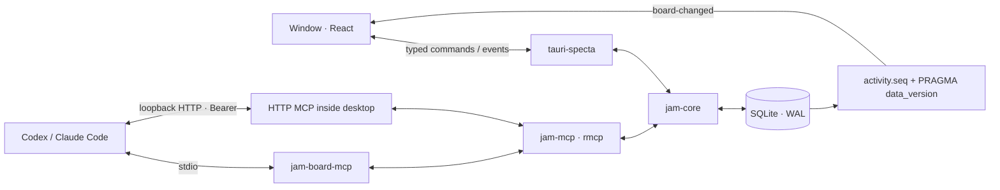

# Architecture

Jam Board runs entirely on the user's computer. There are no accounts, hosted services, analytics, or remote database. Asset files stay in place; SQLite stores references to them.

## Processes and crates

`jam-core` owns migrations, validation, task numbering/ordering, claims, archives, import/export, settings and change feed. It depends on neither Tauri nor rmcp. `jam-mcp` adapts those services to twelve MCP tools, resources, a prompt and authenticated HTTP. `jam-mcp-cli` is the thin stdio binary. `apps/desktop/src-tauri` owns the window, commands, HTTP lifecycle and native integrations; its React frontend lives in `apps/desktop/src`.

The installer places `jam-board.exe` and `jam-board-mcp.exe` together. Installed processes use `%APPDATA%\dev.triton556.jamboard\jam.db`. Development sets `JAM_BOARD_DATA_DIR` to a directory inside `.dev-data`. The CLI resolves `--db`, then `JAM_BOARD_DB`, then `JAM_BOARD_DATA_DIR/jam.db`, then the platform default. The HTTP server exists only while the desktop is open; stdio can work independently.

## One command, one domain implementation

A UI mutation crosses the generated `bindings.ts` through `lib/api.ts`. The Rust command resolves the human from `settings.current_member_id`, runs a core service on `spawn_blocking`, polls the feed, and emits typed events. The frontend never chooses its actor. MCP initialize classifies `clientInfo.name`; `JAM_AGENT_NAME` or `X-Jam-Agent` selects its display identity. Core creates an unknown agent and tracks its heartbeat. Handles/client kinds remain stable when a member is renamed.

Every business mutation writes one activity row in the same transaction. A task form sends only changed fields and its `expectedUpdatedAt`; a stale version returns `conflict` rather than overwriting another actor. Dirty inputs remain local until the user chooses Keep mine or Take theirs. MCP tools use the same core services; their smaller update contract does not expose the desktop version field.

## Concurrency and live delivery

Each Store owns a mutex-protected writer and two read connections. Connections use WAL, foreign keys, NORMAL synchronous mode and a 5000 ms busy timeout. Short writes begin with `BEGIN IMMEDIATE`. Number allocation, fractional positions, renumbering, idempotency, claim checks and their activity row are atomic. Different desktop/stdio processes coordinate through SQLite rather than a second in-memory source of truth.

`ChangeFeed` reads all rows after its monotonic `activity.seq` cursor. UI commands poll immediately. A dedicated connection checks `PRAGMA data_version` every 250 ms to detect commits made by another process. `board-changed` invalidates Query caches; the UI store adds four-second agent highlights, two-second avatar pulses and up to three five-second toasts. No polling of individual cards is needed. Reduced motion preserves color and text feedback.

The table filters/sorts in SQL and renders a bounded virtual window. Its memoized rows have stable callbacks, cached relative times and lightweight CSS avatars/stamps. Production performance scenarios are intentionally manual and hardware-dependent; functional browser tests use the same API via an in-memory bridge and Rust-exported demo fixture.

## Local security and retained data

HTTP binds only to `127.0.0.1`, requires a random 32-byte base64url Bearer token on every request, and rejects non-loopback Origins. Port fallback is 47321–47330. Token regeneration cancels existing HTTP sessions. The UI renders masked snippets; full values are fetched only for explicit Show/Copy. Stdio reserves stdout for MCP and logs to stderr/files.

Recent tool calls stay in a twenty-item memory ring. An authenticated, bounded loopback metadata channel lets a separate stdio process notify the open window; it does not store arguments or a call log in SQLite. Preview authorization resolves an asset ID in Rust and allows only the canonical registered image file through the initially empty asset-protocol scope. No general frontend filesystem read permission is granted.

Tasks and entire jams are archived, never physically deleted. Import creates a new jam, validates references and remaps keys/IDs, while matching existing member handles. Export excludes settings and tokens. Uninstall retains user data so reinstalling does not destroy a jam. Back up `jam.db` using Export JSON or copy the database while all Jam Board processes are closed.

## Startup and release

The native window starts hidden. After app state, initial board data, route content and local fonts are ready, the frontend waits for painted frames, shows the window, and invokes `app_ready`. Rust emits `app-ready` and writes a local `logs/app-ready.json` receipt containing only PID and timestamp. Release measurements compare that timestamp with process creation; it is not telemetry.

Feature screens, the table, task drawer, command palette and Markdown renderer load in separate chunks. Motion and roughjs have dedicated vendor chunks. CI checks both operating systems but only Windows builds the desktop; Linux runtime and macOS are not release targets of this MVP.

## Board preferences and file attachments

Board color mode, optional story-point visibility and the soft In progress WIP limit are stored under the active jam ID in SQLite settings. New jams default to plain paper cards, hidden estimates and a limit of six; estimates remain part of the domain and MCP contract. Asset Grid/List and collapsed-group preferences are application-wide.

Attaching a local file to a task calls one jam-core transaction: validate the active editable task and file, infer its kind/name, insert the asset reference and task link, touch the task version, and append one asset.linked activity event with created=true. No file is copied. A failed link rolls back the asset insertion. Registered-file preview authorization still happens in Rust.
